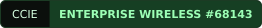

<h1 align="center">Osvaldo Ordonez Milan</h1>

  Network Operations Lead &nbsp;·&nbsp; CCIE Enterprise Wireless #68143 &nbsp;·&nbsp; Network automation &amp; AI tooling

  

 

## Building

<h3>&nbsp; MACUAHUITL</h3>

`Go` `gRPC` `SQLite` `Linux`

A 100% local, TAC-grade desktop platform for multivendor network operations.

- Concurrent SSH evidence collection with playbooks for IOS-XE, NX-OS, WLC, ISE and FTD
- Zero-knowledge credential vault (Argon2id + AES-256-GCM) and tamper-evident audit log
- Built-in diagnostics and an ACL engine that translates between IOS-XE, NX-OS and ASA

 

<h3>&nbsp; Zylant-OS</h3>

`Ubuntu 26.04 LTS` `Bash` `GNOME` `ISO`

My own Linux distribution: Ubuntu 26.04 LTS rebuilt with Tokyo Night style, Xolotl branding and a development environment ready from the first boot.

- Bootable ISO built from the official Ubuntu image, with its own installer and full branding (boot animation, GRUB, login)
- Hardened out of the box: firewall, fingerprint `sudo`, automatic Timeshift snapshots, telemetry removed
- Dev-ready: Ghostty, Docker, uv, Node LTS, VS Code and a tuned GNOME, all scripted and repeatable

 

## Stack

  
  
  
  
  
  
  
  

<table>
  <tr><td><b>Wireless</b></td><td>Catalyst 9800 · AireOS · Catalyst Center · RF design · Wi-Fi 6E/7</td></tr>
  <tr><td><b>Security</b></td><td>Cisco ISE (802.1X, TrustSec) · Firepower FTD/FMC · ASA · Zero Trust</td></tr>
  <tr><td><b>Networking</b></td><td>SD-WAN · SD-Access · OSPF · BGP · EIGRP · VXLAN/EVPN · QoS</td></tr>
  <tr><td><b>Automation &amp; AI</b></td><td>Go · Python · Ansible · REST APIs · IaC · LLM agents</td></tr>
</table>

## Certifications

  
  
  
  
  

## Contact

Mexico · English / Español · Open to conversations about network automation, wireless and AIOps.
